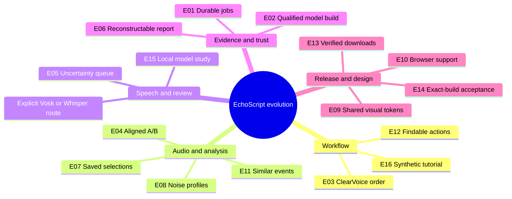

Research date: **14 November 2026**. Status: **research for owner review; implementation and stack migration not approved**. This reference and its unofficial backlog do not change the release gates or promise delivery dates. EchoScript remains an evaluation candidate, with all implemented features available without product-imposed payment gates.

## Decision brief

EchoScript's proposed focus is an approachable, Android-first, local evidence workbench: preserve the source, inspect and enhance a derivative, transcribe with an explicit route, review uncertainty, then export an independently verifiable case. Desktop restoration suites set useful expectations for selection, listening, history and reporting. Their feature breadth does not establish their accuracy on a particular recording or replace evidence validation.

The strongest opportunities are: a visible ordered effects chain; fast, level-matched A/B listening; transcript segments linked to the exact audio revision; resumable work with clear cancellation; and reports that make both settings and limitations readable. These are design recommendations inferred from the comparison, not measured superiority over competitors.

**Recommended stack decision for review:** Vue 3 + TypeScript + compiled Tailwind for the hosted companion, retain the existing React/Fumadocs + TypeScript + Tailwind documentation app, and share palette/spacing terminology with native Compose. A fully Vue-based documentation site is feasible with VitePress, but requires a deliberate migration. No Vue/Tailwind migration, application theme edit or beta rollout is included in this research change.

## Method and boundaries

These are eight relevant comparators selected for forensic speech work, restoration, spectral inspection or review workflow. The order groups use cases; it is not a sales ranking, market-share claim or an audio-quality leaderboard. The research uses vendor documentation and official release records. Vendor performance and legal marketing claims were not adopted as independent findings. Prices and feature-edition tables are deliberately excluded because they do not decide EchoScript's scope.

Evidence labels used below:

- **Documented:** a capability described in the cited primary source, not tested here.
- **Observed:** directly inspected during the synthetic Linux trial described below.
- **Unknown:** not established by the reviewed material. This does not mean a product lacks it.
- **Proposal:** an EchoScript idea requiring review, implementation and appropriate validation.

No case recordings, credentials, transcripts or personal material were supplied to competitors. No paid trial account or subscription was created. Proprietary Windows/macOS products were researched rather than emulated or presented as tested. A controlled Audacity trial is recorded separately. Its tone fixture cannot establish speech intelligibility, transcription accuracy or forensic suitability.

## Eight-product comparison

| Comparator                 | Role and delivery                           | Relevant documented workflow                                         | Trial coverage                                       | EchoScript design cue                         |
| -------------------------- | ------------------------------------------- | -------------------------------------------------------------------- | ---------------------------------------------------- | --------------------------------------------- |
| CEDAR Cambridge            | Specialist forensic/restoration system      | Modular processing and chain/history reports [C1,C2]                 | Documentation only; system access not available      | Reconstructable processing report             |
| CARDINAL MiniLab Suite     | Windows forensic VST plug-ins in a host     | Chain preview, before/after spectrum, settings report [M1]           | Documentation only; Windows host/license absent      | One understandable ordered rack               |
| Diamond Cut DCForensics 11 | Windows forensic audio workstation          | Task panes, sound search, measurements [D1,D2]                       | Documentation only; Windows absent                   | Task-oriented entry points                    |
| iZotope RX 12              | Desktop restoration editor and plug-ins     | Spectral repair, dialogue isolation, module search [R1,R2]           | Documentation only; supported desktop/license absent | Searchable tools and precise selection        |
| Steinberg SpectraLayers 13 | Desktop spectral layer editor               | Selections, layers and component processing [S1,S2]                  | Documentation only; supported desktop/license absent | Branch comparisons and explicit selection     |
| Adobe Audition             | Desktop waveform/multitrack editor          | Noise prints, diagnostics, history [A1,A2,A3]                        | Documentation only; desktop/account absent           | Contextual controls with preview              |
| Acon Digital Acoustica 8   | Desktop editor/restoration/caption workflow | Whisper captions, chain bypass and audit export [AC1-AC4]            | Documentation only; supported desktop absent         | Audio-linked review and repeatable settings   |
| Audacity 4.0.2             | Open-source desktop editor                  | Current release, local editor and optional online features [AU1-AU3] | Synthetic Linux workflow trial                       | Low-friction local import and spectral toggle |

### 1. CEDAR Cambridge

**Documented fundamentals.** CEDAR positions Cambridge among its forensic systems for difficult recordings [C1]. The Report Generator distinguishes a snapshot of the present processing chain from the history since a file was loaded. Reports can be PDF, HTML or XML; cue points can accompany transcription and observations. HTML/XML output can include interface images and processing parameters [C2].

**Specialized value.** The distinction between a current configuration and the work performed is directly relevant to an examiner. A screenshot alone is insufficient to reconstruct a machine-readable sequence.

**EchoScript proposal.** Provide two export views over the same provenance: a concise result summary and the full revision history. Include selected time/frequency/channel bounds, algorithm/model versions, hashes and warnings. Separate these generated records from examiner opinions and review signatures.

**Pitfalls and unknowns.** Encryption, external trust, current system pricing, exact current Cambridge version and automatic speech-recognition behavior were not established here. An older indexed overview mentioned version 13, but the live legacy overview now returns general CEDAR content; this report does not call that version current. Report generation does not itself establish admissibility or laboratory accreditation. **Test status:** documentation only.

### 2. Salient Sciences CARDINAL MiniLab Suite

**Documented fundamentals.** MiniLab uses a compatible audio/video host. The documented tools address tonal interference, rumble, hum and broadband noise. Its Filter Chain combines preview and application, supports presets, and produces an HTML/Word settings report with screen captures. The product page also describes a dual-trace spectrum. Current compatibility lists Windows 10/11 64-bit VST and several hosts [M1].

**Specialized value.** The chain makes processing order explicit, while a host supplies the surrounding editing workflow. This is a better inspiration for ClearVoice's pre/post placement than a hidden cleanup action.

**EchoScript proposal.** Show each stage with its name, enabled state, placement and parameters. Persist the exact chain in a rendered derivative. A preset should populate visible controls and require a new render when modified. Compare bypassed and applied results at the same time position.

**Pitfalls and unknowns.** Hosting plug-ins introduces binary compatibility and state-serialization problems. An arbitrary VST host on Android is outside the current proposal. The page calls the suite ten plug-ins but lists eleven names including Filter Chain; do not rely on that count. Cryptographic chain-of-custody and ASR behavior are unknown from this source. **Test status:** documentation only.

### 3. Diamond Cut DCForensics 11 Audio Laboratory

**Documented fundamentals.** The product describes task panes, suggested filter setting ranges, waveform navigation, format conversion and similar-sound search. Its release history includes Mel-frequency display and comparative measurement improvements. The vendor also lists transcription/time expansion and formant/voice-analysis tools [D1]. These descriptions do not establish automatic transcription or speaker identity.

**Specialized value.** Task-based navigation can let a non-specialist start with a concrete issue such as hum or poor audibility, then inspect the controls chosen for that task.

**EchoScript proposal.** Add a small set of reversible starting presets named for audible problems, each showing what it changes. Pair every recommendation with preview, reset and an explanation of when it may suppress speech. Similar-event search could later help review repeated clicks or tones, with human confirmation.

**Pitfalls and unknowns.** The product page's heading is version 11 while introductory copy still names version 10; its history mentions 11.09. The download page separately labels the DCForensics 11.08 link as not the latest [D2]. No exact current installer was inferred or tested. EchoScript should avoid this same drift by generating download names and status from verified release metadata. Do not import voiceprint/authentication claims into speaker labels. **Test status:** documentation only.

### 4. iZotope RX 12

**Documented fundamentals.** RX offers a standalone spectral restoration editor and plug-ins. Current product material describes dialogue isolation, spectral repair, an assistant, a larger default spectrogram and module search [R1]. Official release notes identify RX 12.1.0, dated 15 October 2026, and list Windows/macOS requirements and fixes for interface, host integration and reopened stem tabs [R2].

**Specialized value.** Searchable modules reduce the cost of learning a large toolset. Making the spectrogram prominent puts the user's selected problem near the processing action.

**EchoScript proposal.** Start with a compact primary workflow and expose detailed controls on demand. A future command search should find actions by both technical and familiar names, such as high-pass and rumble. Preserve parameters and selection visibly when a user returns to a tool.

**Pitfalls and unknowns.** Repair and machine learning can replace or infer signal content. EchoScript should record such operations as derived processing, preserve the original, and avoid implying that a plausible-sounding result proves spoken words. The reviewed product pages do not establish an encrypted evidence vault, independent verifier or qualified transcription route. Those remain unknown, not asserted absences. **Test status:** documentation only; no audio-quality comparison was performed.

### 5. Steinberg SpectraLayers 13

**Documented fundamentals.** The version 13 manual demonstrates selecting a layer, selecting spectral content, moving it to another layer, and muting or adjusting the resulting layer [S1]. Its capability reference lists time/frequency selections, markers, measurement tools, restoration modules and module chains; exact availability varies by product configuration [S2].

**Specialized value.** Layers create an understandable relationship between an isolated component and the composite. A selection is a first-class object rather than a transient mouse gesture.

**EchoScript proposal.** Treat saved selections as versioned objects with channel and frequency bounds. Begin with comparable derived branches rather than a full mixing desk. A later component view could solo the original, a processed derivative and a residual for inspection, clearly identifying any reconstruction.

**Pitfalls and unknowns.** A visually clean spectrogram or extracted voice is not evidence of semantic accuracy. Selection feathering, resampling, phase, timing and layer order need explicit render/export tests. A touch interface should not copy a desktop tool palette at reduced scale. The reviewed manual does not establish evidence encryption or trusted audit verification. **Test status:** documentation only. The observed manual identifies 13.0.30; this is a documentation version, not a tested installed build.

### 6. Adobe Audition

**Documented fundamentals.** Audition combines waveform, multitrack and spectral workflows [A1]. Its restoration guide distinguishes real-time effects from Waveform-only offline processing. Noise reduction can use a noise-only selection captured as a noise print; the guide documents spectral selection and diagnostic tools [A2]. Its history documentation describes undo/redo and returning to earlier editing states [A3].

**Specialized value.** A measured noise profile provides an explicit input to restoration. Different editing contexts explain why a preview and a committed waveform operation may behave differently.

**EchoScript proposal.** Make a noise-profile selection inspectable, hash its parent and settings, and expose a residual-listening mode to help detect speech being removed. Use one canonical render path for transcription and export; if preview differs, state the limitation at the point of use.

**Pitfalls and unknowns.** A noise sample containing quiet speech can bias suppression. Never auto-select a supposed noise-only region solely because VAD was low. Ordinary undo history should not be confused with EchoScript's persistent provenance DAG. The reviewed Audition material did not establish an integrated ASR function; Premiere's transcription capabilities must not be attributed to Audition without separate evidence. **Test status:** documentation only.

### 7. Acon Digital Acoustica 8

**Documented fundamentals.** Acoustica's captions guide uses Whisper models and a selected time range. It describes model/device selection, background transcription, editable time regions, actor assignment and transcript/subtitle export [AC1]. Spectral editing supports channel views, a waveform overlay and time/frequency feathering [AC2]. The chain can be enabled, bypassed, soloed, reordered and saved [AC3].

**Specialized value.** This is the closest documented combination of restoration and caption review in the shortlist. Its audit export deserves separate attention: HTML can carry per-step selections, parameter values and loadable selection/processor state companion files. The guide warns that this history-based export should occur before closing the clip [AC4].

**EchoScript proposal.** Make transcript correction and time boundaries editable together, while preserving every machine and examiner revision. Persist the processing journal across application closure. Export both human-readable reports and machine-readable reconstruction inputs, with independently verifiable hashes.

**Pitfalls and unknowns.** Vendor advice that cleaning can improve recognition is a hypothesis to test per fixture, not a guarantee. Actor assignment does not prove identity, and ASR outputs still need uncertainty review. An audit report is not automatically a cryptographically authenticated case. Exact model retention, account activation and qualified forensic trust were not tested. **Test status:** documentation only; local Whisper inference was not run in this product.

### 8. Audacity 4.0.2

**Documented fundamentals.** The official changelog and release record identify 4.0.2 on 2 November 2026, including fixes involving project integrity, sample rates and Linux import [AU1,AU2]. The current privacy notice covers version 4 and later and describes optional update checking, crash reporting and usage identification [AU3]. This must be distinguished from the archived version 3 privacy notice.

**Observed workflow.** See the separate [synthetic trial record](/docs/research/sandbox-trial). The test used the official x86_64 AppImage, verified against the release asset digest, with an operating-system network restriction and an isolated configuration directory. It did not use a cloud account or personal recording.

**EchoScript proposal.** Keep import, timeline inspection and the waveform/spectral switch immediately discoverable. Offer keyboard and touch equivalents. Add a safe sample case that demonstrates how to return to the original and inspect an enhancement's effect.

**Pitfalls and unknowns.** A general-purpose editor is not an automatic evidence case manager. Audacity's recent integrity fixes are a reminder to exercise reopening, copying, sample-rate changes and recovery on exact builds. The general Linux download page still referenced 4.0.1 during research; the trial used the verified 4.0.2 release instead. **Test status:** limited workflow trial; no ASR or forensic validation.

## Sandbox findings

The Audacity trial completed local import, a full-duration selection, spectral inspection and local mono PCM WAV export. Independent comparison found the exported file byte-identical to the input: 384,044 bytes, 192,000 frames, SHA-256 `1809a959e2a9fd637eb947b9a48d7b2460aab6a3dfaf163ede9d99f2bfc41d36`. The source remained unchanged. No effects were committed and no speech, intelligibility or ASR benchmark was run. The [detailed trial record](/docs/research/sandbox-trial) documents the network guard, navigation limitations, exact settings and measurements.

## Cross-product conclusions and design rules

These are our inferences from the reviewed workflows:

1. **A clean workflow needs a visible state model.** Always identify Source, Working derivative, Rendered derivative and Transcript revision. A large enhance button is useful only if users can see which artifact it affects.
2. **A/B must control loudness and alignment.** A louder output can appear clearer without improving intelligibility. Match listening level without altering evidence bytes, retain raw metrics, and preserve latency/timing offsets.
3. **Pre/post enhancement is an ordered operation.** ClearVoice should have a plain enable switch plus Before effects / After effects placement. Showing it enabled must mean it will actually be included in the selected render. A change invalidates any stale transcription payload approval.
4. **Transcription routing belongs before confirmation.** Keep Vosk as the local default; offer Whisper API explicitly. Show the exact rendered/transmission artifact, provider/model and what leaves the device. Retry must not silently fall back to another provider or reuse expired consent.
5. **An uncertainty queue is more useful than invented confidence.** Keep unintelligible regions, overlap and alternative hypotheses linked to playback. Distinguish model scores from reviewer decisions and never fabricate word-level probabilities.
6. **Persist intent, not a screen callback.** Long render/transcription jobs need authenticated settings, recovery, cancel and retry state. The source remains untouched on failure. Partial results must never be labeled complete.
7. **Minimalism must preserve accessibility.** Large touch targets, visible focus, text labels, sufficient contrast and status text remain necessary. Color must not be the only evidence of selection, error or verification.
8. **Do not reproduce every workstation feature.** ARA, VST hosting, music stem production and live surveillance are costly distractions until the accepted mobile evidence workflow passes its gates.

## Unofficial opportunity backlog

Priorities are discussion order, not promises. **P0** means release correctness; **P1** means core workflow improvement; **P2** means later experiment. Each item is a proposal unless the status explicitly says existing work. See the separate [unofficial checklist](/docs/research/unofficial-backlog) and [GitHub issue #28](https://github.com/TwoWetKnuckles/echoscript/issues/28).

| ID  | Priority | Opportunity and inspiration                                               | Evidence needed before acceptance                                                       |
| --- | -------- | ------------------------------------------------------------------------- | --------------------------------------------------------------------------------------- |
| E01 | P0       | Resolve persistent-job cancellation/re-enqueue behavior; existing PR #27  | Exact-source API 29/36 cancellation, retry, process-death tests; no duplicate artifacts |
| E02 | P0       | Refresh and qualify model-build dependencies; existing security follow-up | Pinned environment, advisory review, export parity and new model hash; native rerun     |
| E03 | P1       | ClearVoice enable + pre/post order; CARDINAL/Acoustica chain pattern      | Disabled bypass, both orders, cancellation, history and payload-hash tests              |
| E04 | P1       | Level-matched A/B and removed-signal listening; spectrum/chain tools      | Alignment and level tests; demonstrate both improvement and speech damage               |
| E05 | P1       | Audio-linked transcript corrections and uncertainty queue; Acoustica      | Playback seek, segment boundaries, genuine score semantics and revision audit           |
| E06 | P1       | Reconstructable processing report; CEDAR/CARDINAL/Acoustica               | Settings, selections, hashes, provenance and independent verification agree             |
| E07 | P1       | Saved time/frequency/channel selections; SpectraLayers/Acoustica          | Feathering, phase, overlap, selection reuse and export parity tests                     |
| E08 | P1       | Measured noise profiles; Audition                                         | Reject mismatched source/rate/channel profiles; evaluate speech suppression             |
| E09 | P1       | Shared visual tokens and concise primary actions; owner direction         | Owner stack AOK, dark/light, contrast, large text, keyboard and touch review            |
| E10 | P1       | Browser minimum and offline asset policy; Tailwind requirements           | Actual supported browser/WebView matrix; no unapproved CDN dependency                   |
| E11 | P2       | Similar-event search; DCForensics/Acoustica                               | Precision/recall on licensed labeled events; no speaker/intent inference                |
| E12 | P2       | Searchable actions and explainable presets; RX/DCForensics                | Findability tests, visible parameters, reset and undo without losing history            |
| E13 | P0       | Release/download consistency and owner signing; observed vendor drift     | Exact tested APK/checksums/certificate, install and upgrade; keep one rollback          |
| E14 | P0       | Full acceptance corpus and resource qualification; EchoScript gates       | Physical-device, accuracy, recovery and seven complete exact-build runs                 |
| E15 | P2       | Optional future local model alternatives                                  | License/size/thermal/accuracy evaluation; provider interface and no silent downloads    |
| E16 | P1       | Synthetic tutorial case; Audacity trial                                   | No sensitive media; guided import/render/review/export with clear reset                 |

## Visual and stack decision record

The proposal is a restrained workbench: near-black graphite canvas, raised blue-gray panels, one cyan action accent, readable neutral text, thin dividers and generous but compact spacing. Keep the waveform/spectrogram as the visual focus; status and provenance should be readable without becoming an admin dashboard. Avoid glow, decorative gradients, dense icon-only toolbars and repeated cards for the same action. These are recommendations, not new application styling.

Palette values below are read from the current native `AppTheme.kt`, not guessed from a marketing image:

| Role           | Dark reference | Light reference |
| -------------- | -------------- | --------------- |
| Canvas         | `#0B1219`      | `#F3F7FB`       |
| Panel          | `#182431`      | `#E8F0F6`       |
| Raised panel   | `#223141`      | `#E1EAF1`       |
| Primary text   | `#E0E8EF`      | `#15212C`       |
| Secondary text | `#B0C2D2`      | `#445566`       |
| Accent         | `#65D8E6`      | `#006A76`       |

These are starting tokens, not a completed WCAG contrast audit. Keep warning/error/verified labels in words. Reuse the native spacing/radius vocabulary where it fits the web, without forcing identical layouts onto a phone and a documentation article.

| Surface                 | Current implementation                                       | Recommended option A                        | Alternative option B                                       |
| ----------------------- | ------------------------------------------------------------ | ------------------------------------------- | ---------------------------------------------------------- |
| Hosted companion        | TypeScript browser companion                                 | Vue 3 SFCs + TypeScript + compiled Tailwind | Keep current renderer and add Tailwind after parity review |
| Docs                    | Next/React/Fumadocs, TypeScript and Tailwind already present | Retain, use shared tokens                   | Migrate deliberately to Vue/VitePress                      |
| Native Android          | Kotlin/Compose Material                                      | Keep native, map visual tokens              | WebView rewrite would be separate architecture work        |
| GitHub repository pages | GitHub-flavored Markdown                                     | Consistent wording, links, SVG/PNG assets   | Vue/Tailwind static project site on GitHub Pages           |

Vue supports TypeScript and single-file components [T1,T2]. Tailwind's Vite integration compiles CSS rather than requiring a production browser CDN [T3]. VitePress is a Vue-based documentation generator [T5]. GitHub's repository UI renders Markdown; a separate GitHub Pages site can serve built HTML/CSS/JavaScript [T6,T7]. Repository content cannot restyle GitHub's own navigation or run an arbitrary Vue application inside a README.

**Compatibility concern:** Tailwind 4's documented browser floor includes Chrome 111, Safari 16.4 and Firefox 128 [T4]. Android 10 is not a browser version. Validate the actual browser/WebView engine, avoid unsupported utilities, and publish a clear minimum before selecting the final web build. Do not weaken the native offline requirement to accommodate a theme.

**Migration pitfalls:** Tailwind preflight/global CSS crossing app boundaries; dynamic class names missing from generated CSS; duplicate framework runtime; MDX/Vue incompatibility; route, anchor, search and Markdown-export regressions; hosted secrets accidentally moved into frontend bundles; loss of offline caching; long recordings retained twice in JS memory; and inaccessible canvas-only controls. Workbench audio processing should stay behind existing typed contracts and off the UI thread where appropriate.

**Owner decision required before implementation:** choose A (Vue companion, existing Fumadocs docs, native Compose, shared tokens) or B (Vue companion plus a VitePress documentation migration), and approve the bounded design/refactor scope. Existing release gates remain mandatory under either choice.

## Mindmap

The [standalone mindmap](https://github.com/TwoWetKnuckles/echoscript/blob/docs/product-discovery-20261114/docs/research/EVOLUTION-MINDMAP.svg) uses the same IDs as the backlog. Its five branches distinguish release obligations from research ideas. The editable Graphviz source is [included](https://github.com/TwoWetKnuckles/echoscript/blob/docs/product-discovery-20261114/docs/research/EVOLUTION-MINDMAP.dot). The image is a research reference, not a new application theme. The structure below is also editable in GitHub:

## Readiness and unfinished work

Baseline reviewed: `main` at `e6371f0b60d3ffc683d0fad763d04bfcbac9c7e4`; runtime draft [PR #27](https://github.com/TwoWetKnuckles/echoscript/pull/27) at `20009a72c1f1ce2875784b0f9b0d9f4307170fd0`. The published installer remains Candidate 0.6 revision 1; research does not change it.

Earlier source `73b8266` passed its scoped quality run, including emulator recovery subsets. The newer [run 43565607222](https://github.com/TwoWetKnuckles/echoscript/actions/runs/43565607222) has six successful quality jobs and failed API 29 and API 36 device jobs. Both final device reports identify the new scheduled-cancellation test expecting WorkManager CANCELLED but observing FAILED. Diagnose the scheduler/worker cancellation race and verify the encrypted journal outcome before accepting a correction. Durable journal cancellation must remain the assertion; a generic failure must not be masked. A successful earlier commit does not qualify the later source. Build-tool dependency qualification and exact-model reruns also remain unfinished.

All eleven mandatory gates in [release-gates.json](https://github.com/TwoWetKnuckles/echoscript/blob/feature/clearvoice-whisper-beta/specs/release-gates.json) remain unaccepted: DEVICE_UI, EVIDENCE, REAL_WORKFLOW, DEVICE_RESOURCES, RECOVERY, ENHANCEMENT, SPEECH, TEAM_PORTABILITY, DISTRIBUTION, GOVERNANCE and SEVEN_FULL_RUNS. Work includes physical phones/tablets and accessibility, complete enhancement scope/parity, representative speech evaluation, clean-device recovery/trust, team authorization, owner-controlled production signing and the accepted full workflow. Some require implementation; others require owner/device/deployment inputs. Seven engine or synthetic subsets must not be relabeled seven full accepted runs.

The next sequence is: owner research/stack AOK; repair and qualify the pending runtime work; implement only the agreed design scope; refactor with behavior parity; complete exact-build gates; then package, archive, sign and publish the qualified beta. Historical backups are already retained. Do not delete additional published builds or claim a renewed live deployment from an expired/protected URL.

## Maintenance policy

Use this report, the mindmap and the linked unofficial issue when proposing future changes. Cite an idea ID in the proposal, state its user benefit and evidence boundary, and record an owner decision before promoting it into release scope. Recheck vendor sources before relying on a version-sensitive fact. Add dated observations instead of silently changing the research snapshot. Copy concepts, not vendor branding, proprietary assets or source code. Research findings never waive QA, expand evidence uploads or enable automatic cloud fallback.

## Primary sources

All accessed 14 November 2026. A source supports the nearby documented facts; recommendations and risk analysis are our inferences. No vendor claim was independently certified.

- **C1:** [CEDAR audio forensics](https://cedaraudio.com/applications/forensics) — product family and forensic positioning; not independent accuracy validation.
- **C2:** [CEDAR Report Generator](https://cedaraudio.com/products/cambridge/camreport) — chain/history reports, cue points, parameters and export formats.
- **M1:** [CARDINAL MiniLab Suite](https://www.salientsciences.com/product/minilab-suite/) — chains, filtering, reports, spectrum and host compatibility; inconsistent plug-in count noted above.
- **D1:** [DCForensics product and revision history](https://diamondcut.com/product/diamond-cut-forensics-10-6-audio-laboratory/) — task panes, analysis and versions; stale introductory name noted.
- **D2:** [Diamond Cut downloads](https://diamondcut.com/dwnload/) — current/older installer labels; exact latest forensic patch unresolved.
- **R1:** [iZotope RX](https://www.izotope.com/products/rx-standard) — restoration modules and interface concepts; marketing claims not measurements.
- **R2:** [RX Standard release notes](https://www.izotope.com/pages/release-notes/rx-standard) — RX 12.1.0 date, compatibility and fixes.
- **S1:** [SpectraLayers 13 getting started](https://download.steinberg.net/downloads_software/SpectraLayers_13/help/Pro/_getting_started.html) — spectral selection and layer operations.
- **S2:** [SpectraLayers 13 capability reference](https://download.steinberg.net/downloads_software/SpectraLayers_13/help/Elements/_spectralayers_editions_comparison.html) — capability availability; no EchoScript feature restrictions inferred.
- **A1:** [Adobe Audition](https://www.adobe.com/products/audition.html) — waveform, spectral and multitrack scope.
- **A2:** [Audition noise reduction/restoration guide](https://helpx.adobe.com/audition/desktop/effects-reference/noise-reduction-restoration-effects.html) — noise prints and offline/real-time boundaries.
- **A3:** [Audition undo, redo and history](https://helpx.adobe.com/audition/desktop/editing-audio-files/undo-redo-history.html) — editing history, not cryptographic provenance.
- **AC1:** [Acoustica automatic captions](https://acondigital.com/help/acoustica8/automatic-captions/) — Whisper, selected ranges, background jobs and editable captions.
- **AC2:** [Acoustica spectral editing](https://acondigital.com/help/acoustica8/spectral-editing/) — channel views, overlays and selection tools.
- **AC3:** [Acoustica processing chain](https://acondigital.com/help/acoustica8/the-processing-chain/) — bypass, solo, ordering, presets and rendering.
- **AC4:** [Acoustica audit export](https://acondigital.com/help/acoustica8/export-audit-trail/) — history report and reloadable companion state.
- **AU1:** [Audacity changelog](https://www.audacityteam.org/changelog/) — current release record.
- **AU2:** [Audacity 4.0.2 official release](https://github.com/audacity/audacity/releases/tag/Audacity-4.0.2) — release notes and asset digest used for the trial.
- **AU3:** [Audacity 4 privacy notice](https://www.audacityteam.org/legal/privacy-notice/) — optional network features; not the archived version 3 notice.
- **T1:** [Vue introduction](https://vuejs.org/guide/introduction) — component architecture.
- **T2:** [Vue with TypeScript](https://vuejs.org/guide/typescript/overview) — typed component tooling.
- **T3:** [Tailwind with Vite](https://tailwindcss.com/docs/installation/using-vite) — build integration.
- **T4:** [Tailwind compatibility](https://tailwindcss.com/docs/compatibility) — browser minimum and modern-CSS limits.
- **T5:** [VitePress overview](https://vitepress.dev/guide/what-is-vitepress) — Vue documentation alternative.
- **T6:** [Writing on GitHub](https://docs.github.com/en/get-started/writing-on-github/getting-started-with-writing-and-formatting-on-github/about-writing-and-formatting-on-github) — Markdown repository surfaces.
- **T7:** [GitHub Pages overview](https://docs.github.com/en/pages/getting-started-with-github-pages/what-is-github-pages) — separate static site hosting.
